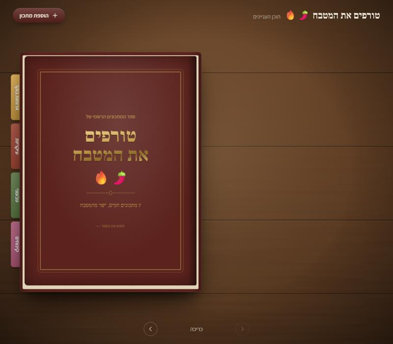
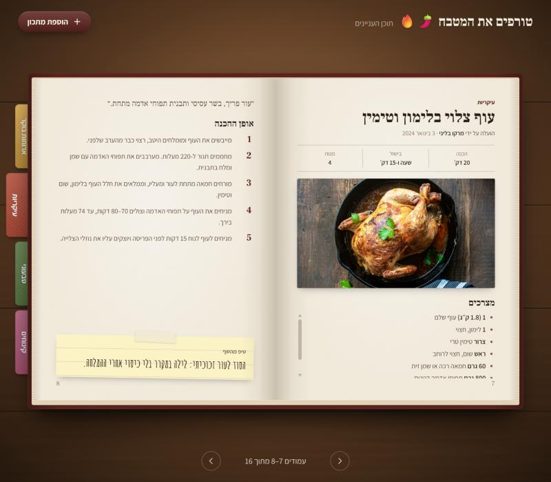
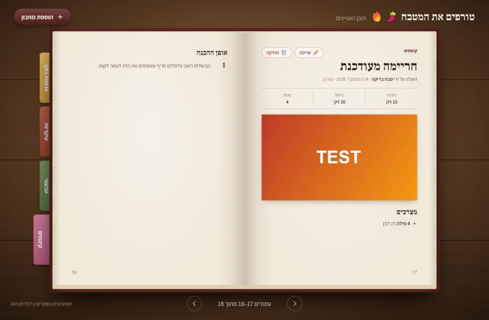
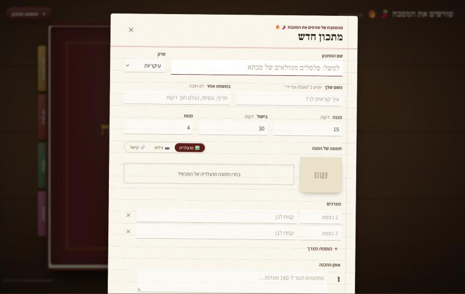
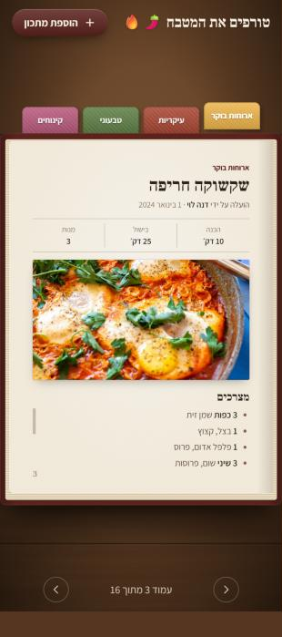

<div dir="rtl">

# ספר המתכונים הרשמי של טורפים את המטבח🌶️🔥

ספר מתכונים דיגיטלי בקוד פתוח שנראה ומתדפדף כמו ספר אמיתי. מדפדפים בספר כרוך בעור עם דפים שמתעקלים באמת, קופצים בין הפרקים בעזרת לשוניות בד, ומוסיפים מתכונים משלכם על כרטיס מתכון מרופד שורות.

**לצפייה בספר:** https://dor2500.github.io/digital-recipe-book/



## מה יש בספר

- **ספר בעברית שנפתח מימין לשמאל**, כמו ספר עברי אמיתי: הדפים מתהפכים משמאל לימין
- **שני עמודים פתוחים במחשב, עמוד אחד בטלפון**, עם אנימציית הדפדוף בשניהם
- **תוכן עניינים חי** שמתעדכן לבד כשמוסיפים מתכון, ובלחיצה על מתכון הספר מדפדף אליו
- **לשוניות פרקים** (ארוחות בוקר, עיקריות, טבעוני, קינוחים) שקופצות לתחילת כל פרק
- **הוספת מתכון** עם מצרכים ושלבים שאפשר להוסיף ולהסיר, וטיפ מהשף
- **תמונה של המנה מהגלריה של המכשיר**, צילום ישיר מהמצלמה, או קישור לתמונה
- **רשום מי העלה כל מתכון** ומתי
- **רק מי שהעלה מתכון יכול לערוך או למחוק אותו**: הכפתורים מופיעים רק לו

| מתכון פתוח | תוכן העניינים |
| --- | --- |
|  |  |

| עריכה ומחיקה למי שהעלה | כרטיס מתכון חדש | בטלפון |
| --- | --- | --- |
|  |  |  |

## הרצה מקומית

</div>

```bash
npm install
npm run dev
```

<div dir="rtl">

ופותחים את http://localhost:3000. בלי שום הגדרה, הספר מציג את מתכוני הדוגמה, ומה שמוסיפים נשמר בדפדפן שלכם.

## איפה נשמרים המתכונים

**בלי הגדרות (ברירת מחדל):** כל מתכון נשמר בדפדפן של מי שהוסיף אותו. כל דפדפן מקבל מזהה אקראי, וזה מה שמסמן מי העלה מה. זה עובד גם באתר ב-GitHub Pages, אבל כל מבקר רואה רק את המתכונים שהוא עצמו הוסיף.

**כדי שכולם יראו את אותו ספר:** מחברים Supabase (חינמי):

1. פותחים פרויקט ב-Supabase ומריצים את [`supabase/schema.sql`](supabase/schema.sql) ב-SQL Editor.
2. מפעילים ב-Authentication ← Sign In / Providers את **Allow anonymous sign-ins**. כל מבקר מקבל משתמש אנונימי, וכללי האבטחה במסד הנתונים מאפשרים רק לו לערוך ולמחוק את המתכונים שלו.
3. מעתיקים את `.env.example` ל-`.env.local` וממלאים `NEXT_PUBLIC_SUPABASE_URL` ו-`NEXT_PUBLIC_SUPABASE_ANON_KEY`.
4. מפעילים מחדש את `npm run dev`.

## העלאה ל-GitHub Pages

</div>

```bash
GITHUB_PAGES=true npx next build
touch out/.nojekyll
```

<div dir="rtl">

התיקייה `out/` היא האתר המוכן. מעלים את התוכן שלה לענף `gh-pages`. אם שם המאגר שונה מ-`digital-recipe-book`, מגדירים גם `PAGES_BASE_PATH=/<שם-המאגר>`.

## מבנה הפרויקט

</div>

```
src/
├─ app/                     פונטים (Frank Ruhl Libre, Assistant, Amatic SC), שולחן העץ, עיצוב הנייר והעור
├─ components/
│  ├─ BookApp.tsx           גודל הספר, מצב העמוד, כפתורים, הוספה/עריכה/מחיקה
│  ├─ book/
│  │  ├─ Book.tsx           הספר המתדפדף (react-pageflip), הפוך לכיוון ימין-לשמאל
│  │  ├─ Paper.tsx          עמוד בודד (נייר רך או כריכה קשה)
│  │  ├─ PageContents.tsx   כריכה, תוכן עניינים, עמודי מתכון
│  │  └─ BookmarkTabs.tsx   לשוניות הפרקים
│  └─ form/
│     ├─ RecipeFormModal.tsx     כרטיס המתכון (הוספה ועריכה)
│     └─ ConfirmDeleteDialog.tsx אישור מחיקה
├─ data/mockRecipes.ts      מתכוני דוגמה
├─ hooks/                   useRecipes, useElementSize
└─ lib/
   ├─ types.ts              מבנה המתכון והפרקים
   ├─ bookLayout.ts         מתכונים ← עמודים, תוכן עניינים ויעדי הלשוניות
   └─ storage/              ממשק האחסון + אחסון בדפדפן ו-Supabase
supabase/schema.sql         טבלה, הרשאות לפי מעלה המתכון, דלי תמונות
```

<div dir="rtl">

## הערות למפתחים

- **כיוון ימין-לשמאל:** ספריית הדפדוף יודעת לדפדף רק משמאל לימין, אז `Book.tsx` מעביר לה את העמודים בסדר הפוך ופותח אותה בסוף. מחוץ לרכיב הזה כל מספרי העמודים הם לפי סדר הקריאה.
- **רענון הספר:** הספרייה קוראת את ההגדרות פעם אחת, ולכן `BookApp` טוען את הספר מחדש (דרך `key`) כשמשתנים הגודל, הכיוון, מספר העמודים או תוכן מתכון.
- **כפתורים בתוך עמוד:** הספרייה מעבירה לחיצה רק כשהיעד הוא בדיוק `<button>`, ולכן לילדים של כפתורים בתוך עמודים יש `pointer-events: none`.
- **מצב קפדני כבוי:** `reactStrictMode` כבוי, כי הטעינה הכפולה של React במצב פיתוח משאירה דף תקוע באמצע דפדוף.

תמונות מתכוני הדוגמה מ-[Unsplash](https://unsplash.com).

## רישיון

MIT

</div>
